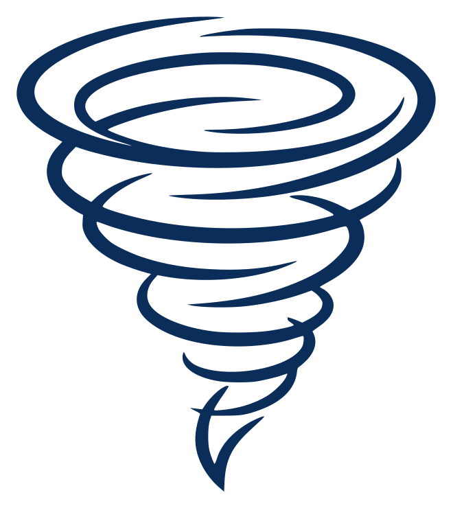

::::: {.hero}

:::: {.hero-text}

{.wordmark fig-alt="STORM — Quantitative Risk Collective"}

::: {.tagline}

A research collective of **Square Management**

:::

::::

::: {.hero-mark}

{fig-alt=""}

:::

:::::

:::: {.about}

```{=html}
<div class="pills" role="group" aria-label="About STORM">
  <button type="button" aria-pressed="true" data-panel="bref">in brief</button>
  <button type="button" aria-pressed="false" data-panel="plus">more</button>
  <button type="button" aria-pressed="false" data-panel="approche">approach</button>
</div>
```

::: {#panel-bref .panel}

We develop quantitative methods to measure, monitor and stress-test risk — where it actually hides: in the tails of the distribution.

:::

::: {#panel-plus .panel .is-hidden}

STORM is the quantitative research collective of **Square Management**. We develop statistical, econometric and machine-learning methodologies for measuring, monitoring and stress-testing risk.

Our current work focuses on financial risk: credit, model validation, stress testing, climate and geopolitical risk.

:::

::: {#panel-approche .panel .is-hidden}

**01 — The mean is not the risk.** We propagate the full conditional distribution, or start from the breaking threshold.

**02 — Building blocks, not replacements.** Each block plugs into the institution's already-validated internal model. No redevelopment.

:::

::::

:::: {.section-wide .home-section}

```{=html}
<div class="sh"><h2>News</h2><a href="news/index.html">see all →</a></div>
```

::: {#news}

:::

```{=html}
<div class="sh"><h2>Research</h2><a href="research/index.html">the areas →</a></div>
```

::: {#axes}

:::

::::
