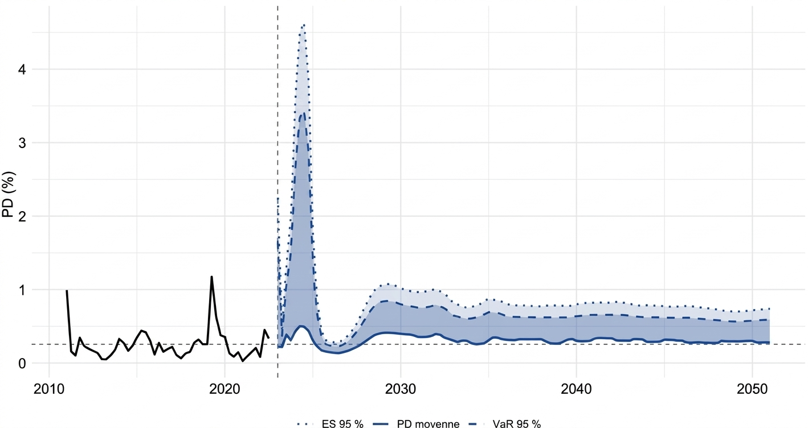

::: {.note-pdf}

[Télécharger la note (PDF)](../../assets/notes/STORM-note-atrisk-climat.pdf){download="STORM-note-atrisk-climat.pdf"}

:::

::: {.standfirst}

[En bref]{.lede}
Les exercices de stress testing du risque de crédit reposent traditionnellement sur une projection en valeur centrale : à partir d’un scénario macroéconomique donné, une trajectoire attendue de probabilités de défaut (PD) est dérivée, dont la moyenne résume l’exposition future. Cette approche demeure incomplète : le risque ne se révèle pas dans la moyenne mais se concentre dans les états de stress sévère. Deux scénarios peuvent ainsi produire des trajectoires moyennes proches tout en masquant des niveaux de vulnérabilité très différents dans les queues de distribution. Cette note applique l’approche at-Risk au risque de crédit sous les scénarios climatiques du NGFS : en associant régressions quantiles et lissage par une loi skew-t, elle reconstruit l’intégralité de la distribution conditionnelle du facteur systémique Merton-Vasicek à ces scénarios pour en dériver directement la Value-at-Risk (VaR) et l’Expected Shortfall (ES) d’un portefeuille de crédit.

:::

::: {.message}

[Message central]{.label}

L’approche at-Risk ne se substitue pas aux cadres de stress testing existants : elle les prolonge en révélant la forme complète de la distribution du risque sous scénario. Appliquée aux trajectoires climatiques du NGFS, elle démontre qu’un scénario n’est pas seulement plus ou moins sévère par sa moyenne, mais par l’épaisseur et l’asymétrie de sa queue défavorable. Les scénarios de transition rapide (Below 2°C, Net Zero 2050) génèrent ainsi des queues de risque nettement plus épaisses à court terme en raison de la brutalité des réajustements monétaires requis.

Cet outil trouve une application directe pour les établissements bancaires dans le cadre du Pilier 2 (ICAAP) et des exigences de la directive CRD 6. Alors que la réglementation impose de retenir un scénario central dans l’évaluation des risques et des plans de transition, la méthodologie at-Risk permet de tester la sensibilité du portefeuille et la résilience du modèle d’affaires si ce scénario central ne se réalisait pas. Elle offre ainsi aux équipes risques une métrique chiffrée pour alimenter les exercices de stress tests internes et challenger la solidité des fonds propres face à des trajectoires alternatives.

:::

## 1. Une asymétrie des risques masquée par la moyenne

La modélisation du risque de crédit s’inscrit traditionnellement dans le cadre structurel Merton-Vasicek / ASRF (Gordy, 2003 ; Vasicek, 1987), où les probabilités de défaut dépendent d’un facteur systémique latent $z_t$ résumant l’état macro-financier.

Cependant, les approches classiques souffrent d’une limite structurelle : elles projettent uniquement la trajectoire centrale de ce facteur. Or, comme le montrent Schechtman et Gaglianone (2012) ainsi qu’Adrian et al. (2019) dans le cadre du Growth-at-Risk, les vulnérabilités économiques et financières agissent de manière asymétrique et se lisent principalement dans les queues de distribution. Aydemir et al. (2024) confirment que les variables macroéconomiques n’impactent pas le risque de crédit de la même façon au centre et dans les zones de stress extrême.

::: {.why}

[Pourquoi c’est important]{.label}

- **Aveuglement à la sévérité extrême.** Deux scénarios aux trajectoires moyennes identiques peuvent masquer des niveaux de risque de queue du simple au double.
- **Impact des politiques de transition.** Les chocs macro-financiers de court terme liés aux politiques climatiques affectent la volatilité et l’asymétrie du risque bien plus que son niveau moyen.
- **Mesures de queue pour IFRS 9 et l’ICAAP.** L’évaluation des provisions et l’estimation du capital interne (Pilier 2) nécessitent des métriques dynamiques centrées sur la queue défavorable, hors de portée d’une simple projection en valeur centrale.
- **Cohérence structurelle des mesures de risque.** Le cadre garantit le respect des propriétés théoriques des métriques de queue : absence de croisement des quantiles (monotonie stricte) et respect systématique de la hiérarchie du risque (l’Expected Shortfall est, par construction, toujours supérieur à la VaR).

:::

## 2. Du taux de défaut à la distribution at-Risk : l’architecture

Le cadre proposé par Flament et al. (2025) s’articule en quatre étapes modulaires (figure 1) :

1. **Extraction du facteur systémique $z_t$.** Inversion de la formule ASRF à partir des taux de défaut observés ($DR_t$), de la PD de long terme ($PD_{LT}$) et de la corrélation $\rho$ :

    $$z_t = \frac{\Phi^{-1}(PD_{LT}) - \sqrt{1-\rho}\Phi^{-1}(DR_t)}{\sqrt{\rho}}$$
1. **Régressions quantiles conditionnelles.** Estimation des quantiles $Q_\tau(z_{t+h}\vert{}X_t) = X_t' \beta_h(\tau)$ sur une grille fine de quantiles $\tau \in (0,1)$ pour capturer la dynamique des queues.
1. **Lissage paramétrique par loi Skew-t.** Ajustement d’une loi skew-t d’Azzalini et Capitanio (2003) sur les quantiles estimés pour dériver en forme continue le niveau, la dispersion, l’asymétrie et l’épaisseur de queue.
1. **Rétrotransformation en PD.** Conversion des métriques de risque ($z$) en probabilités de défaut ($PD$) via la fonction ASRF :

    $$PD(z) = \Phi\left(\frac{\Phi^{-1}(PD_{LT}) - \sqrt{\rho}z}{\sqrt{1-\rho}}\right)$$

::: {#schema}

:::

::: {.why}

[Ce que le cadre apporte]{.label}

- **Information complète** : Délivre simultanément la PD moyenne, la VaR-at-Risk à 95% et l’Expected Shortfall à 95%.
- **Ancrage réglementaire et académique** : Réutilise le moteur Merton-Vasicek/ASRF tout en intégrant les avancées de l’économie quantile (Growth-at-Risk).
- **Flexibilité paramétrique** : La loi skew-t capte l’asymétrie et l’épaississement des queues en période de crise que la loi gaussienne ignore

:::

## 3. Application empirique : projections sous scénarios climatiques NGFS

L’approche at-Risk est appliquée aux trajectoires de transition climatique fournies par le NGFS (Phase IV, sept scénarios) afin d’évaluer la réponse du risque de crédit sur un portefeuille d’entreprises. L’exercice s’articule comme suit :

1. **Choix des variables et traitement des données**

    L’analyse s’appuie sur une série historique trimestrielle de taux de défaut agrégés ainsi que sur un ensemble de variables macro-financières internationales (États-Unis, zone euro, Japon). Afin d’aligner le contenu informationnel des régresseurs sur l’horizon temporel du facteur systémique $z_t$ (qui mesure la probabilité de défaillance sur les 12 mois à venir), toutes les variables sont transformées en glissement annuel. Après validation de la stationnarité, la sélection des variables procède en deux temps. Une présélection univariée par critère BIC au quantile défavorable $\tau = 5\%$ est suivie d’une recherche multivariée exhaustive.
1. **Estimation de la dynamique quantile et lissage**

    Une fois le modèle sélectionné, les régressions quantiles sont estimées pour chaque horizon $h$ sur une grille fine de quantiles $\tau \in (0,1)$. Pour passer de ces quantiles à une distribution continue et exploitable, une loi skew-t d’Azzalini et Capitanio (2003) est ajustée par minimisation de l’écart quadratique entre quantiles théoriques et quantiles estimés. Les quatre paramètres de la loi calibrés à chaque période permettent d’obtenir la déformation de la queue gauche du facteur systémique $z_t$, notamment lors des crises historiques.
1. **Projection sous scénarios NGFS et rétrotransformation**

    Les trajectoires macroéconomiques propres à chacun des sept scénarios NGFS sont injectées dans les équations quantiles pour projeter la distribution conditionnelle de $z_{t+h}$ jusqu’à l’horizon 2050.  Chaque distribution projetée du facteur $z$ est ensuite rétrotransformée de manière analytique via la fonction de répartition ASRF/Merton-Vasicek :

    - PD moyenne : obtenue en intégrant la fonction de transformation sur la loi skew-t projetée.

    - Value-at-Risk ($\text{VaR}_{95\%}$) : calculée en appliquant la rétrotransformation au $5^e$ percentile de la distribution de $z_t$.

    - Expected Shortfall ($\text{ES}_{95\%}$) : évalué comme la moyenne rétrotransformée au-delà du seuil de VaR.

Alors que les PD moyennes stagnent dans un canal étroit (0,30% à 0,32% en régime de croisière) et ne permettent pas de départager les scénarios NGFS, l’Expected Shortfall monte jusqu’à 8,66%, révélant des risques de queue d’un ordre de grandeur supérieur.  Les scénarios de transition ordonnée et ambitieuse (Below 2°C, Net Zero 2050) apparaissent comme les plus sévères sur le canal macro-financier de court terme. Cela s’explique par la brutalité des variations de politiques monétaires et de spreads requises pour décarboner rapidement l’économie, instantanément captée dans la queue gauche du modèle at-Risk.

::: {.note-figure}

{fig-alt="Projection de la probabilité de défaut sous le scénario Below 2 °C (méthodologie at-Risk) : réponse moyenne, Value-at-Risk (95 %) et Expected Shortfall (95 %)."}

::: {.note-cap}
Figure 2. Projection de la probabilité de défaut sous le scénario *Below $2^\circ\text{C}$* (méthodologie *at-Risk*) : réponse moyenne, Value-at-Risk ($95\%$) et Expected Shortfall ($95\%$).
:::

:::

| Scénario NGFS | PD moy. max. (%) | VaR 95% max. (%) | ES 95% max. (%) | Gap max. (ES – PD moy) (pp) |
|:--|:-:|:-:|:-:|:-:|
| Below 2 °C | 0,70 | 6,34 | 8,66 | 7,96 |
| Net Zero 2050 | 1,62 | 6,39 | 8,47 | 6,84 |
| Nationally Determined Contrib. | 0,58 | 5,63 | 7,74 | 7,17 |
| Baseline | 1,32 | 5,48 | 7,33 | 6,01 |
| Current Policies | 1,18 | 5,09 | 6,79 | 5,60 |
| Fragmented World | 1,18 | 5,09 | 6,79 | 5,60 |
| Delayed transition | 1,28 | 5,08 | 6,76 | 5,47 |

: Tableau 1. Synthèse des scénarios NGFS : niveaux maximaux projetés (fenêtre 2023-Q1 à 2050-Q4, triés par ES décroissant). Les maxima sont atteints en 2024-Q1 pour l’ensemble des scénarios. Current Policies et Fragmented World affichent des valeurs identiques.

::: {.retenir}

[Lecture pour les équipes risques]{.label}

L’enseignement n’est pas « la transition écologique va faire grimper les défauts ». C’est que la trajectoire centrale d’un scénario masque l’essentiel de sa sévérité : la forme de sa distribution, l’épaisseur de sa queue et l’asymétrie de sa réponse, qui s’écartent fortement de la simple valeur moyenne. Les scénarios NGFS se distinguent peu en moyenne mais révèlent des écarts majeurs dans leur queue défavorable sous l’effet des ajustements macro-financiers de court terme. Le climat n’est qu’un banc d’essai : cette même architecture *at-Risk* s’applique à tout autre catalogue de scénarios internes, prudentiels ou macroéconomiques.

:::

## 4. Mise en œuvre

Le déploiement de l’approche at-Risk s’effectue sans rupture avec la chaîne de modélisation existante:

1. **Extraction.** Inversion de la formule ASRF/Merton-Vasicek sur l’historique des défauts internes ou sectoriels.
1. **Estimation.** Calibration des régressions quantiles et ajustement de la loi skew-t (exploitant le package R dédié développé par Flament et al. (2025)).
1. **Projection.** Injection des trajectoires de scénarios (NGFS, BCE, internes) pour alimenter les stress test.

::: {.retenir}

[À retenir pour chaque équipe]{.label}

- **Stress testing / ICAAP** : Capacité à hiérarchiser des scénarios aux trajectoires centrales quasi identiques grâce à la mesure de l’Expected Shortfall.
- **Provisionnement IFRS 9** : Calibration affinée des ajustements discrétionnaires (overlays) en intégrant l’asymétrie et la déformation des queues de distribution sous stress.
- **Validation / Risque de Modèle** : Chaîne économétrique documentée et appuyée sur des publications académiques de référence.

:::

Le groupe Square Management se tient à la disposition des équipes intéressées pour échanger sur l’application de ce cadre à leurs portefeuilles.

## Article de recherche associé

Flament, G., Hurlin, C. & Lajaunie, Q. (2026). *The at-Risk Approach: A New Tool for Stress Tests and Overlays.* **Annals of Operations Research**, 361, 27–60.



## Références

::: {.refs}

Adrian, T., Boyarchenko, N. & Giannone, D. (2019). Vulnerable growth. *American Economic Review*, 109(4), 1263–1289.

Aydemir, R., Atik, Z. & Guloglu, B. (2024). Macro stress testing the credit risk of conventional and participation banks in Turkey: a nonparametric quantile regression approach. *Eastern European Economics*, 62(6), 727–761.

Azzalini, A. & Capitanio, A. (2003). Distributions generated by perturbation of symmetry with emphasis on a multivariate skew t-distribution. *Journal of the Royal Statistical Society Series B: Statistical Methodology*, 65(2), 367–389.

Flament, G., Hurlin, C. & Lajaunie, Q. (2025). The at-Risk approach: a new tool for stress tests and overlays. *Annals of Operations Research*, 1–34.

Gordy, M. B. (2003). A risk-factor model foundation for ratings-based bank capital rules. *Journal of Financial Intermediation*, 12(3), 199–232.

Schechtman, R. & Gaglianone, W. P. (2012). Macro stress testing of credit risk focused on the tails. *Journal of Financial Stability*, 8(3), 174–192.

Vasicek, O. A. (1987). *Probability of loss on loan portfolio*. KMV.

:::
