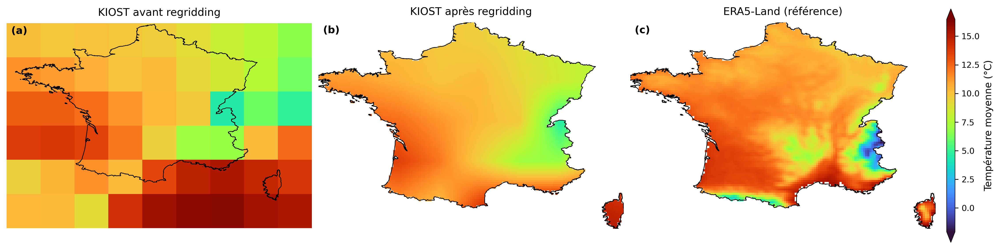
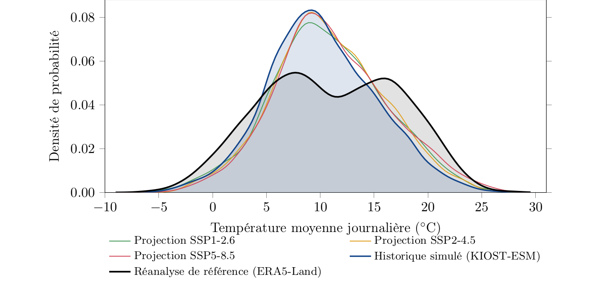
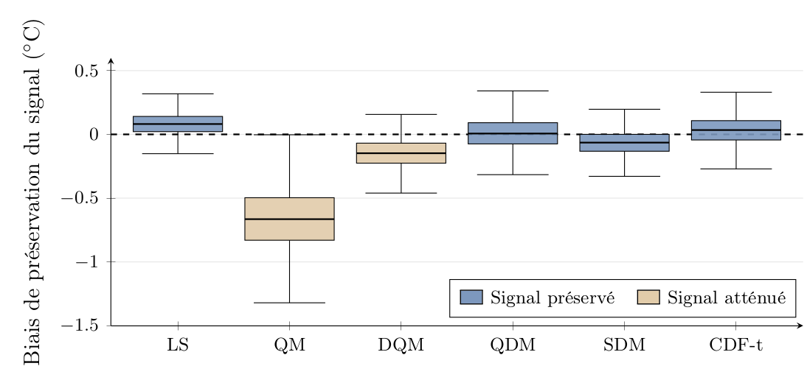
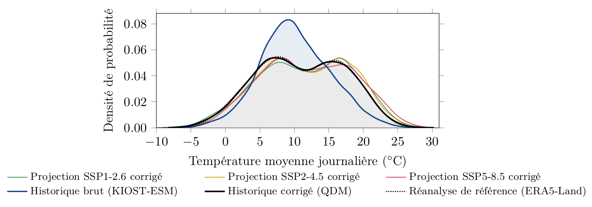
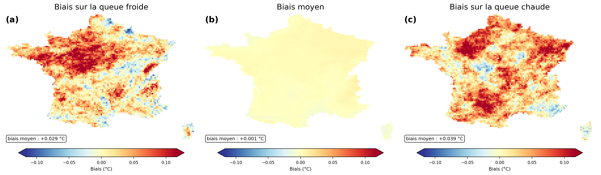

::: {.note-pdf}

[Télécharger la note (PDF)](../../assets/notes/STORM-note-downscaling.pdf){download="STORM-note-downscaling.pdf"}

:::

::: {.standfirst}

[En bref]{.lede}
L’évaluation prospective des risques physiques s’appuie sur les projections climatiques produites par la communauté scientifique internationale, dont la génération la plus récente aujourd’hui finalisée est le CMIP6. Ces projections sont produites par des modèles globaux (GCM), conçus pour l’étude du système climatique à l’échelle planétaire, dont les sorties brutes ne peuvent être utilisées directement pour évaluer un aléa sur des expositions localisées. En effet, leur résolution, souvent supérieure à la centaine de kilomètres, ne permet pas de rattacher une exposition à son niveau d’aléa propre, deux sites distants de plusieurs dizaines de kilomètres partageant la même valeur simulée. Cette discrétisation produit un effet de moyennisation qui atténue les pointes locales, et les sorties des modèles sous-estiment de façon documentée l’ampleur et la fréquence des événements extrêmes, c’est-à-dire précisément ceux qui concentrent les impacts économiques et financiers. Les méthodes de *downscaling* statistique *distribution-wise* y répondent en alignant les lois marginales simulées sur celles d’une réanalyse de référence, pour un coût de mise en œuvre modeste et sans recourir à une simulation climatique à une échelle fine. Une application à la température journalière sur la France illustre l’apport de ces méthodes et les critères qui doivent présider au choix d’une variante dans un exercice prospectif.

:::

::: {.message}

[Message central]{.label}

Une correction de biais des sorties d’un modèle climatique poursuit deux objectifs distincts : ramener la distribution simulée sur celle de la référence, et préserver autant que possible le changement que le modèle projette entre la période historique et le futur. Rien ne garantit qu’une méthode satisfaisant le premier réussisse sur le second. Entre deux méthodes aux performances d’ajustement quasi identiques sur l’historique, l’une peut amputer une part sensible du signal de changement climatique aux quantiles extrêmes, quand l’autre le préserve intégralement. La qualité d’ajustement constitue dès lors un préalable et non un critère de sélection à lui seul, la préservation du signal prenant le pas dans un exercice prospectif.

:::

## 1. Pourquoi les sorties brutes des modèles climatiques ne suffisent pas

L’intensification des aléas physiques se transmet aux bilans financiers par une chaîne aujourd’hui documentée : l’aléa frappe des expositions localisées (collatéral immobilier, sites industriels, contreparties agricoles), dont la vulnérabilité détermine un dommage physique qui se traduit *in fine* en pertes financières, hausse du risque de crédit pour les banques et alourdissement de la sinistralité pour les assureurs. En France, la CCR évalue à environ +40 % la croissance de la charge des catastrophes naturelles à l’horizon 2050 sous le seul effet climatique dans le scénario médian RCP 4.5, et jusqu’à +60 % une fois intégrée la croissance du parc assuré (Caisse Centrale de Réassurance, 2023). Projeter ces aléas suppose de mobiliser les sorties du *Coupled Model Intercomparison Project*, dont la sixième phase (CMIP6) constitue la base scientifique du sixième rapport d’évaluation du GIEC. Deux limites s’opposent toutefois à leur usage direct.

**La résolution spatiale.** Les modèles climatiques globaux simulent le système terrestre sur une grille dont la maille dépasse fréquemment la centaine de kilomètres, si bien que le territoire métropolitain n’est couvert que par une trentaine de cellules dans les modèles les plus grossiers. Ramener ces champs sur une grille plus fine relève de l’interpolation spatiale, qui lisse les valeurs simulées sans créer d’information locale nouvelle. Les effets orographiques et le gradient littoral, présents dans la réanalyse, demeurent ainsi absents du champ interpolé (Figure 1). C’est cet écart que le *downscaling* statistique vise à combler.

::: {.note-figure}

{fig-alt="Trois cartes de France de la température journalière : sortie brute du modèle KIOST-ESM, même champ interpolé, et réanalyse ERA5-Land."}

::: {.note-cap}
Figure 1. Résolution native d’un modèle CMIP6, champ interpolé et référence (KIOST-ESM et ERA5-Land, 1^er^ janvier 1990).

*Clés de lecture — Panneau (a) : champ brut de température journalière sur la grille native du modèle (∼1,9°×1,25°). Panneau (b) : même champ après interpolation bilinéaire sur la grille 0,1° d’ERA5-Land. Panneau (c) : champ ERA5-Land reconstitué pour le même jour.*
:::

:::

**Le biais de distribution.** La seconde limite est plus lourde de conséquences. Les modèles du CMIP sous-estiment fréquemment l’ampleur et la fréquence des événements extrêmes (Maraun et Widmann, 2018 ; Vautard et al., 2020). La Figure 2 en donne la mesure dans le cas de la température journalière à 2 mètres au-dessus du sol sur la France métropolitaine : la densité simulée sur la période historique est quasi unimodale, quand la distribution de référence présente deux modes distincts, correspondant aux régimes hivernal et estival. Le même défaut se retrouve sur les projections, dont les distributions conservent cette forme unimodale quel que soit le scénario d’émissions et se déplacent le long de l’axe des températures sans retrouver la structure de la référence. Ce défaut échappe par ailleurs à une approche multi-modèles : l’agrégation d’un ensemble de GCM rend compte de la divergence entre modèles, non de ce qu’ils partagent, et un biais commun se retrouve aussi bien dans la médiane que dans les bornes de l’enveloppe d’incertitude. Corriger ces projections suppose donc de rectifier la forme de la loi simulée, et non son seul niveau.

Des projections corrigées existent, mais ne sont pas toujours librement accessibles. Le recours à un fournisseur tiers expose à un coût récurrent, à une dépendance et à un effet « boîte noire » difficilement compatibles avec les exigences d’auditabilité qui s’imposent aux établissements bancaires et assurantiels. Maîtriser ces méthodes en interne relève dès lors autant de la souveraineté sur la donnée que de la capacité à justifier le dispositif auprès du superviseur.

## 2. Les méthodes *distribution-wise* : principe et variantes {#methodes}

Les approches *Model Output Statistics* (MOS) établissent une relation statistique directe entre les sorties brutes d’un modèle climatique donné et une référence locale, typiquement une réanalyse climatique telle qu’ERA5-Land, de résolution native de 9 km et diffusée sur une grille régulière de 0,1°. Une réanalyse n’est pas à proprement parler un jeu d’observations : elle résulte d’une simulation numérique contrainte par des mesures issues de sources multiples, stations, radiosondages, satellites ou bouées. ERA5-Land en est une déclinaison terrestre, obtenue en rejouant le modèle de surface d’ERA5 à plus fine résolution ; les observations n’y sont pas directement intégrées, mais influencent ses champs par l’intermédiaire des forçages atmosphériques hérités d’ERA5. Ces produits constituent la référence usuelle pour l’évaluation des modèles climatiques et la correction de leurs biais.

La relation, apprise sur la période historique, est ensuite appliquée aux projections du même modèle. La procédure comporte quatre étapes : alignement spatial des grilles par *regridding*, apprentissage de plusieurs méthodes candidates sur un échantillon d’apprentissage, sélection sur un échantillon de test indépendant, puis recalibrage sur l’intégralité de l’historique et application aux scénarios futurs.

::: {.note-figure}

{fig-alt="Densités de la température moyenne journalière : historique simulé par KIOST-ESM et projections SSP1-2.6, SSP2-4.5 et SSP5-8.5, quasi unimodales, contre la réanalyse ERA5-Land, bimodale."}

::: {.note-cap}
Figure 2. Distributions de température journalière simulée et de référence sur la France métropolitaine.

*Clés de lecture — Densités de probabilité estimées par noyau, sur l’ensemble des cellules du domaine.*
:::

:::

Au sein de ce cadre, les méthodes dites *distribution-wise* agissent sur la distribution marginale des variables simulées, cellule par cellule. Ce choix tient à la nature de l’objet que l’on cherche à corriger. Les méthodes alternatives, dites *event-wise*, apparient simulation et réanalyse à la même date et reposent le plus souvent sur l’estimation d’une espérance conditionnelle : elles restituent alors le comportement moyen et lissent les queues de la distribution, alors que ce sont précisément elles qui portent l’information de risque. Elles supposent en outre une correspondance temporelle entre simulation et réanalyse que les simulations climatiques ne vérifient pas, faute d’être synchronisées avec la chronologie réelle du climat. Maraun et Widmann (2018) concluent que le cadre MOS ne peut être appliqué rigoureusement à de telles simulations que dans une perspective *distribution-wise*. C’est celle que retient la présente note.

::: {.why}

[Formulation]{.label}

Soit $Y^{\text{hist}}_{i,j}$ la variable climatique simulée sur la période historique au point de grille $(i, j)$, et $Y^{\text{ref}}_{i,j}$ la variable correspondante issue de la réanalyse de référence au même point. On estime une transformation $\mathcal{T}_{i,j}$ telle que

$$Y^{\text{ref}}_{i,j} \overset{d}{=} \mathcal{T}_{i,j}\left(Y^{\text{hist}}_{i,j}\right),$$

où $\overset{d}{=}$ désigne l’égalité en loi. Estimée sur l’historique, cette transformation est ensuite appliquée aux simulations futures du même modèle, $\hat{y}^{\,\text{proj}}_{t,i,j} = \mathcal{T}_{i,j}\left(y^{\text{proj}}_{t,i,j}\right)$. Seules les lois marginales sont mises en relation, sans qu’aucun appariement date à date entre simulation et référence ne soit requis.

:::

Les variantes se distinguent par la forme retenue pour $\mathcal{T}_{i,j}$ et par la manière dont elles traitent le signal de changement climatique. Le *Linear Scaling* (LS, Lenderink et al., 2007) corrige le seul premier moment par une translation. Le *Quantile Mapping* (QM) corrige l’ensemble de la distribution en faisant correspondre quantile à quantile la loi simulée et la loi de référence ; la transformation estimée sur l’historique est alors appliquée telle quelle aux projections, ce qui suppose que les biais, quantile par quantile, demeurent invariants dans le temps, hypothèse d’autant plus contestable que l’horizon de projection s’allonge. Quatre extensions relâchent cette hypothèse, et toutes mobilisent pour cela la distribution projetée par le modèle. Le *Detrended QM* (DQM, Cannon et al., 2015) retire la tendance avant correction et la réintroduit ensuite, mais ne transporte que le décalage de moyenne ; le *Quantile Delta Mapping* (QDM, Cannon et al., 2015) préserve explicitement le changement projeté pour chaque quantile ; le *Scaled Distribution Mapping* (SDM, Switanek et al., 2017) procède par ajustement des périodes de retour, et la CDF-t (Michelangeli et al., 2009) modélise directement le déplacement de la loi simulée entre historique et futur. Toutes sont estimées conditionnellement au jour de l’année, sur une fenêtre glissante de 31 jours : un même niveau de température n’occupe pas le même rang dans la distribution selon la saison, et une correction unique confondrait les régimes hivernal et estival. Ce conditionnement n’apparie que des positions dans le cycle saisonnier et non des dates au sens strict.

## 3. Application : température journalière sur la France {#application}

Les six méthodes présentées à la [section 2](#methodes) sont mises en œuvre sur les températures moyennes journalières à 2 mètres au dessus du sol simulées par KIOST-ESM (Pak et al., 2021), dont la maille compte parmi les plus larges des modèles CMIP6 sur l’Europe de l’Ouest, ce qui en fait un candidat particulièrement illustratif. La référence est la réanalyse ERA5-Land ; la période historique 1990–2014 est découpée chronologiquement en un échantillon d’apprentissage (1990–2004) et un échantillon de test (2010–2014), ce dernier strictement réservé à la comparaison finale.

### Ce que la correction apporte

Le Tableau 1 rapporte les performances sur les échantillons d’apprentissage et de test. Toutes les méthodes améliorent nettement la sortie brute. Le *Kling–Gupta Efficiency* (KGE, Gupta et al., 2009), qui décompose explicitement biais, corrélation et rapport d’écarts-types, progresse sur le test de 0,658 à 0,725–0,740, et sa troisième composante $\sigma_f$ passe de 0,81 à 1,02–1,04. Ces indicateurs portent sur la distribution rassemblée sur l’année, dont la variance est dominée par le cycle saisonnier, si bien que $\sigma_f$ en mesure l’amplitude. Les six méthodes corrigées se tiennent dans un intervalle très resserré sur les deux échantillons, les écarts entre elles relevant de l’ordre du centième. Le recul d’environ six centièmes de KGE entre apprentissage et test leur est par ailleurs commun, signe qu’il tient à la différence de climat entre les deux fenêtres et non à l’une d’entre elles en particulier.

| Méthode | Apprentissage RMSE | Apprentissage KGE | Apprentissage $\sigma_f$ | Test RMSE | Test KGE | Test $\sigma_f$ |
|:--|:-:|:-:|:-:|:-:|:-:|:-:|
| [Sortie brute (KIOST-ESM)]{.raw} | [4,708]{.raw} | [0,576]{.raw} | [0,79]{.raw} | [4,543]{.raw} | [0,658]{.raw} | [0,81]{.raw} |
| *Linear Scaling* (LS) | 4,117 | 0,787 | 1,01 | 4,399 | 0,725 | 1,04 |
| *Quantile Mapping* (QM) | 4,038 | 0,794 | [1,00]{.best} | [4,281]{.best} | [0,740]{.best} | [1,02]{.best} |
| *Detrended QM* (DQM) | 4,038 | 0,794 | [1,00]{.best} | 4,323 | 0,735 | 1,03 |
| *Quantile Delta Mapping* (QDM) | 4,039 | 0,794 | [1,00]{.best} | 4,332 | 0,730 | 1,03 |
| *Scaled Distribution Mapping* (SDM) | 4,044 | 0,794 | [1,00]{.best} | 4,325 | 0,729 | 1,03 |
| CDF-t | [4,032]{.best} | [0,795]{.best} | [1,00]{.best} | 4,356 | 0,726 | 1,03 |

: Tableau 1. Performances sur les échantillons d’apprentissage et de test. *Clés de lecture — RMSE en °C (plus faible = meilleur) ; KGE, optimum à 1. $\sigma_f = \sigma_{\hat y} / \sigma_{y^{\text{ref}}}$, troisième composante du KGE, mesure la restitution de l’amplitude de la variabilité, optimum à 1. Valeur la plus favorable en bleu, sortie brute en gris.*

### Sur quel critère départager les variantes

Les six méthodes étant à ce point resserrées, les indicateurs d’ajustement ne permettent pas de trancher. Le critère décisif pour un exercice prospectif est ailleurs, dans la capacité de la correction à transporter sans le déformer le signal de changement climatique porté par le modèle. Une correction est en effet estimée sur la période historique mais appliquée à des projections, et rien ne garantit *a priori* qu’elle laisse intacte l’évolution que le modèle projette entre ces deux périodes.

Ce diagnostic se formalise en comparant, pour une statistique d’intérêt $s$, l’évolution future de la série corrigée à celle de la sortie brute du modèle :

$$\Delta B_{i,j}(s) = \left[ s\left(\hat{y}^{\text{proj}}_{i,j}\right) - s\left(\hat{y}^{\text{hist}}_{i,j}\right) \right] - \left[ s\left(y^{\text{proj}}_{G,i,j}\right) - s\left(y^{\text{hist}}_{G,i,j}\right) \right], \tag{1}$$

où $\hat{y}$ désigne la série corrigée et $y_G$ la sortie brute du modèle. Le premier crochet mesure le changement climatique présent dans la série corrigée, le second celui que porte le modèle. Un $\Delta B_{i,j}$ nul signifie que la correction a restitué exactement l’amplitude du changement projeté ; un $\Delta B_{i,j}$ négatif, qu’elle l’a atténué. La statistique $s$ retenue ici est le 95^e^ centile, qui isole le comportement des extrêmes chauds, et le diagnostic est conduit sous le scénario SSP5-8.5, qui maximise l’amplitude du réchauffement projeté et constitue donc le test le plus exigeant.

La Figure 3 donne la distribution spatiale de cet écart pour les six méthodes. Le *Quantile Mapping* en retire 0,65 °C en médiane, conséquence directe de son hypothèse de stationnarité des quantiles : en appliquant aux projections une transformation estimée sur le seul historique, il ramène les quantiles futurs vers leur position passée et ampute d’autant le réchauffement des extrêmes. Le DQM, qui ne transporte que le décalage de moyenne, corrige l’essentiel de ce défaut mais laisse subsister un biais de queue résiduel de −0,15 °C. Les quatre méthodes restantes se tiennent au voisinage de zéro, avec des médianes comprises entre −0,06 et +0,08 °C, soit un ordre de grandeur en dessous.

::: {.note-figure}

{fig-alt="Boîtes à moustaches du biais de préservation du signal pour les six méthodes : LS, QDM, SDM et CDF-t proches de zéro, QM nettement négatif, DQM légèrement négatif."}

::: {.note-cap}
Figure 3. Biais de préservation du signal climatique $\Delta B_{i,j}$ au 95^e^ centile (extrêmes chauds), SSP5-8.5 à l’horizon 2050.

*Clés de lecture — Chaque boîte agrège la distribution spatiale de $\Delta B_{i,j}$, défini par l’équation (1), sur les 6 375 pixels terrestres du domaine, en °C ; moustaches de Tukey (1,5× écart interquartile). La ligne tiretée marque la préservation exacte du signal.*
:::

:::

Ce diagnostic départage ce que les scores d’ajustement ne départageaient pas, et il inverse la hiérarchie : le QM, pourtant le mieux classé au KGE, est celui qui déforme le plus le signal prospectif, c’est-à-dire précisément la grandeur que l’on cherche à projeter. Restent quatre méthodes ; parmi elles, le QDM préserve le signal quantile par quantile plutôt qu’en moyenne, propriété qui le distingue du LS, et son KGE de test est le meilleur des quatre. C’est la méthode retenue.

### Ce que la correction produit

Le QDM est recalibré sur l’intégralité de la période historique (1990-2014), puis appliqué aux projections. La Figure 4 en donne le résultat, à mettre en regard de la Figure 2. Sur l’historique, la distribution corrigée se superpose à celle de la référence et retrouve la bimodalité que la sortie brute ne restituait pas, son mode autour de 9 °C se scindant en deux régimes distincts. Les queues suivent le même mouvement, la densité corrigée s’étendant des deux côtés bien au-delà de l’enveloppe de la sortie brute.

Les trois distributions projetées, corrigées par la même transformation, se déplacent vers les températures chaudes d’autant plus que le scénario est sévère, mais pas de la même manière. Sous SSP1-2.6 et SSP2-4.5, la distribution se translate en conservant sa structure ; sous SSP5-8.5, la queue supérieure s’étale et la densité au-delà de 25 °C dépasse de plusieurs fois celle des deux autres scénarios. C’est cette déformation des queues, et non le seul décalage de moyenne, que la correction QDM préserve.

::: {.note-figure}

{fig-alt="Densités de la température après correction QDM : l’historique corrigé se superpose à la réanalyse et retrouve deux modes ; les projections corrigées se déplacent vers les températures chaudes."}

::: {.note-cap}
Figure 4. Effet de la correction QDM sur les distributions de température (France métropolitaine).

*Clés de lecture — Densités de probabilité estimées par noyau, sur l’ensemble des cellules du domaine.*
:::

:::

### Le biais résiduel après correction

Il reste à mesurer ce que la correction laisse subsister, en comparant cellule par cellule une statistique de la série corrigée à celle de la réanalyse,

$$B_{i,j}(s) = s\left(\hat{y}_{i,j}\right) - s\left(y^{\text{ref}}_{i,j}\right), \tag{2}$$

où, contrairement à $\Delta B_{i,j}$ qui portait sur une évolution entre deux périodes, il s’agit d’un écart de niveau, positif en cas de surestimation et négatif en cas de sous-estimation. Le calcul est conduit sur la moyenne, qui rend compte du corps de la distribution, et sur les 5^e^ et 95^e^ centiles, qui en isolent les deux queues.

::: {.note-figure}

{fig-alt="Trois cartes de France du biais résiduel après correction QDM : queue froide, moyenne et queue chaude ; biais quasi nul sur la moyenne, biais chaud faible sur les queues."}

::: {.note-cap}
Figure 5. Biais résiduel $B_{i,j}$ de la correction QDM sur l’historique (France métropolitaine, 1990–2014) : (a) queue froide (5^e^ centile), (b) moyenne, (c) queue chaude (95^e^ centile).

*Clés de lecture — Échelle de couleur divergente centrée sur zéro : le jaune pâle marque un biais nul, le rouge une surestimation, le bleu une sous-estimation. L’encart de chaque panneau indique le biais spatial moyen correspondant.*
:::

:::

Les résultats sont sans ambiguïté sur le corps de la distribution : le biais moyen s’établit à +0,001 °C en moyenne spatiale et la carte correspondante est uniforme (Figure 5, panneau b), ce qui est le comportement recherché. Les queues conservent en revanche un biais chaud résiduel, faible mais systématique et spatialement structuré : +0,029 °C sur la queue froide et +0,039 °C sur la queue chaude, concentrés sur le Bassin parisien et le quart Nord-Est, tandis que les reliefs et la Corse restent proches de zéro.

Évalué hors échantillon, la transformation apprise sur 1990–2004 étant appliquée à la période de test, le biais reste faible mais se creuse sur les queues, +0,2 °C sur la moyenne contre +0,5 °C sur la queue froide et +0,4 °C sur la queue chaude. La sortie brute présente au contraire un biais de +2,5 °C sur la queue froide et de −0,8 °C sur la queue chaude, soit une distribution resserrée de près de trois degrés que la correction ramène à son amplitude de référence.

## 4. Limites et pistes d’extension

::: {.why}

[Deux limites]{.label}

**La référence borne la résolution atteignable.** Une correction MOS ne peut produire une information plus fine que le jeu sur lequel elle est calibrée, soit une dizaine de kilomètres avec ERA5-Land. La portée de cette borne dépend de l’origine de la finesse requise. Elle pèse peu lorsque celle-ci vient du terrain, comme pour une inondation fluviale dont l’emprise est déterminée par un modèle numérique de terrain à partir d’une précipitation agrégée sur le bassin versant (Sampson et al., 2015). Elle devient contraignante lorsque la finesse doit venir de la variable elle-même, comme pour les précipitations intenses dans le cas d’une inondation pluviale, dont l’échelle kilométrique n’est restituée que moyennée, donc atténuée, par une réanalyse. La lever suppose de mobiliser des covariables statiques à très haute résolution, telles que les modèles numériques de terrain, les indices de végétation ou l’occupation des sols, pour atteindre l’échelle décamétrique (Immerzeel et al., 2009 ; Jia et al., 2011).

**Un biais résiduel subsiste hors échantillon.** La correction est apprise sur une période et appliquée à une autre, sans garantie que la structure du biais soit demeurée identique, l’écart croissant avec la distance à la période de calibration. Le résidu se concentre en général sur les queues, plus sensibles que le corps de la distribution à un changement de climatologie : dans l’application présentée, il atteint +0,5 °C sur la queue froide et +0,4 °C sur la queue chaude, contre +0,2 °C sur la moyenne. Son sens n’est pas neutre selon l’aléa considéré, un biais chaud majorant l’intensité des vagues de chaleur et sous-estimant celle des épisodes de gel.

:::

L’arrivée de CMIP7 et d’ERA6 améliorera la qualité des simulations sans supprimer le besoin d’une correction, des modèles régionaux déjà mieux résolus que les modèles globaux du CMIP6 continuant d’exiger un ajustement de leurs sorties avant tout usage local (Tabari et al., 2016).

Le prolongement naturel du dispositif consiste à convertir le forçage corrigé en aléa, en le couplant à des modèles d’impact, hydrologiques pour l’inondation ou de bilan hydrique des sols pour le retrait-gonflement des argiles, afin de dériver des courbes d’aléa par période de retour aux horizons futurs. Pour un portefeuille géolocalisé, l’enjeu est direct, c’est à ce niveau de résolution qu’un actif bascule d’« exposé » à « non exposé ».

## 5. Mise en œuvre

La chaîne repose sur des données publiques. Le *Climate Data Store* de Copernicus donne accès, au format NetCDF, aux projections des modèles CMIP6 comme aux réanalyses ERA5 et ERA5-Land, et couvre les variables climatiques mobilisées pour la modélisation des aléas physiques : au-delà de la température retenue ici, les précipitations, la vitesse du vent, l’humidité des sols ou le ruissellement y sont disponibles au moins au pas journalier. La méthode s’applique ainsi à tout aléa, moyennant les variantes propres à chaque variable, une correction sur les précipitations appelant par exemple un traitement multiplicatif et une gestion explicite des jours secs (Switanek et al., 2017). Les compétences requises relèvent de la statistique et de la programmation, non de la modélisation physique du climat, et aucun supercalculateur n’est nécessaire, ce qui distingue cette voie du *downscaling* dynamique. L’essentiel du coût tient au volume des données à manipuler plutôt qu’à la complexité des traitements.

Un pilote sur une variable et un modèle suffit à éprouver la chaîne de bout en bout. L’extension à un ensemble multi-modèles se fait ensuite à architecture inchangée, mais non sans coût, une transformation MOS étant propre au modèle sur lequel elle a été estimée : chaque membre de l’ensemble doit être corrigé séparément avant agrégation. Reste un choix à arrêter avant l’estimation, celui du critère de sélection, l’écart observé à la [section 3](#application) entre le classement au KGE et celui obtenu sur la préservation du signal montrant que l’indicateur retenu commande le résultat. Le documenter dès la conception conditionne la capacité à justifier le dispositif auprès du superviseur.

Le groupe Square Management se tient à la disposition des équipes intéressées pour échanger sur la mise en œuvre d’une chaîne de *downscaling* statistique adaptée aux aléas et aux zones d’exposition qui les concernent.



## Références

::: {.refs}

Caisse Centrale de Réassurance (2023). *Conséquences du changement climatique sur le coût des catastrophes naturelles en France à horizon 2050*. Technical report, CCR, Paris.

Cannon, A. J., Sobie, S. R. & Murdock, T. Q. (2015). Bias correction of GCM precipitation by quantile mapping: how well do methods preserve changes in quantiles and extremes? *Journal of Climate*, 28(17), 6938–6959.

Gupta, H. V., Kling, H., Yilmaz, K. K. & Martinez, G. F. (2009). Decomposition of the mean squared error and NSE performance criteria: Implications for improving hydrological modelling. *Journal of Hydrology*, 377(1–2), 80–91.

Immerzeel, W. W., Rutten, M. M. & Droogers, P. (2009). Spatial downscaling of TRMM precipitation using vegetative response on the Iberian Peninsula. *Remote Sensing of Environment*, 113(2), 362–370.

Jia, S., Zhu, W., Lü, A. & Yan, T. (2011). A statistical spatial downscaling algorithm of TRMM precipitation based on NDVI and DEM in the Qaidam Basin of China. *Remote Sensing of Environment*, 115(12), 3069–3079.

Lenderink, G., Buishand, A. & van Deursen, W. (2007). Estimates of future discharges of the river Rhine using two scenario methodologies: direct versus delta approach. *Hydrology and Earth System Sciences*, 11(3), 1145–1159.

Maraun, D. & Widmann, M. (2018). *Statistical downscaling and bias correction for climate research*. Cambridge University Press.

Michelangeli, P.-A., Vrac, M. & Loukos, H. (2009). Probabilistic downscaling approaches: Application to wind cumulative distribution functions. *Geophysical Research Letters*, 36(11).

Pak, G., Noh, Y., Lee, M.-I., Yeh, S.-W., Kim, D., Kim, S.-Y., Lee, J.-L., Lee, H. J., Hyun, S.-H., Lee, K.-Y., et al. (2021). Korea Institute of Ocean Science and Technology Earth System Model and its simulation characteristics. *Ocean Science Journal*, 56(1), 18–45.

Sampson, C. C., Smith, A. M., Bates, P. D., Neal, J. C., Alfieri, L. & Freer, J. E. (2015). A high-resolution global flood hazard model. *Water Resources Research*, 51(9), 7358–7381.

Switanek, M. B., Troch, P. A., Castro, C. L., Leuprecht, A., Chang, H.-I., Mukherjee, R. & Demaria, E. (2017). Scaled distribution mapping: a bias correction method that preserves raw climate model projected changes. *Hydrology and Earth System Sciences*, 21(6), 2649–2666.

Tabari, H., De Troch, R., Giot, O., Hamdi, R., Termonia, P., Saeed, S., Brisson, E., Van Lipzig, N. & Willems, P. (2016). Local impact analysis of climate change on precipitation extremes: are high-resolution climate models needed for realistic simulations? *Hydrology and Earth System Sciences*, 20(9), 3843–3857.

Vautard, R., van Aalst, M., Boucher, O., Drouin, A., Haustein, K., Kreienkamp, F., Van Oldenborgh, G. J., Otto, F. E., Ribes, A., Robin, Y., et al. (2020). Human contribution to the record-breaking June and July 2019 heatwaves in Western Europe. *Environmental Research Letters*, 15(9), 094077.

:::
