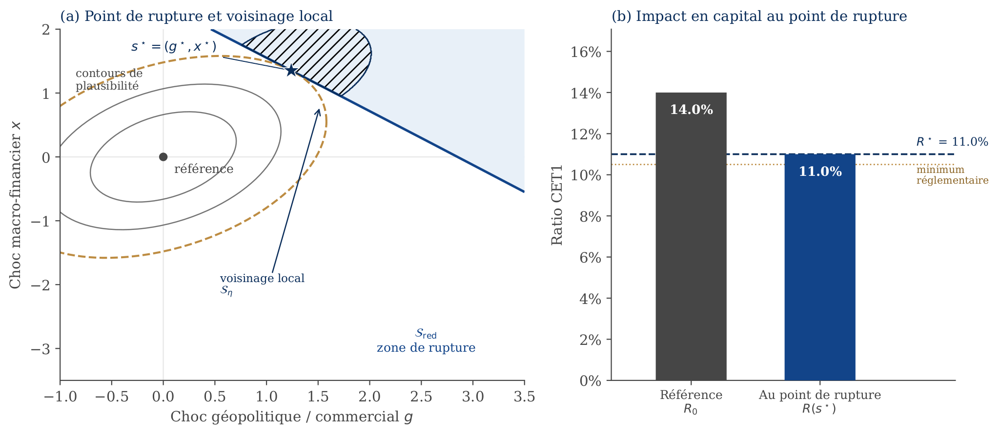

::: {.note-pdf}

[Télécharger la note (PDF)](../../assets/notes/STORM-note-reverse-stress-test.pdf){download="STORM-note-reverse-stress-test.pdf"}

:::

::: {.standfirst}

[En bref]{.lede}
Les stress tests classiques répondent à la question « combien coûterait ce scénario ? ». Le régulateur pose désormais aussi la question inverse : « quel scénario coûterait cela ? » L’exercice thématique 2026 de la BCE demande ainsi aux banques d’identifier les événements géopolitiques susceptibles d’entamer leur capital CET1 d’au moins 300 points de base (ECB, 2025). Cette note présente une architecture opérationnelle qui transforme un seuil de capital en un *scénario de rupture* : la combinaison de chocs la plus plausible capable de franchir le seuil, assortie de son voisinage de scénarios proches. Elle réutilise les modèles internes existants ; un portefeuille de crédit stylisé sert de preuve de concept.

:::

::: {.message}

[Message central]{.label}

Le reverse stress testing inverse la logique habituelle : au lieu de mesurer l’impact d’un scénario donné, on part de la condition de défaillance et on cherche, parmi tous les scénarios possibles, celui qui la produit avec la **plus grande plausibilité**. Formulé comme une recherche sous contrainte, l’exercice cesse d’être un récit : il produit un objet documenté, chiffré et challengeable. L’illustration géopolitique n’est qu’une preuve de concept ; la même architecture s’applique aux chocs macroéconomiques, climatiques, de taux, sectoriels ou de marché.

:::

## 1. Ce que les scénarios prescrits ne couvrent pas

Le stress testing standard part d’un scénario prescrit et en mesure l’impact. Le reverse stress testing part du résultat qui compte, un franchissement de seuil, et remonte vers le scénario qui l’expliquerait. Les deux sont complémentaires (BCBS, 2009, 2018) :

```{=html}
<div class="rst-compare" role="img" aria-label="Stress testing forward : un scénario connu, dont on mesure l’impact. Reverse stress testing : un seuil franchi, dont on recherche le scénario.">
  <div class="row fwd"><span class="lab">Stress testing forward</span><span class="box">Scénario<br>connu</span><span class="arr" aria-hidden="true">→</span><span class="box">Impact mesuré<br>(pertes, capital)</span></div>
  <div class="row rev"><span class="lab">Reverse stress testing</span><span class="box">Seuil<br><i>R</i><sup>★</sup> franchi</span><span class="arr" aria-hidden="true">→</span><span class="box">Scénario recherché<br><i>s</i><sup>★</sup> ?</span></div>
</div>
```

::: {.why}

[Pourquoi c’est important]{.label}

- **Un angle mort structurel.** Un exercice forward n’évalue que les scénarios que l’on a pensé à écrire ; une combinaison de chocs dangereuse pour le profil propre de l’établissement peut ne figurer dans aucun catalogue. Le reverse stress testing va la chercher directement.
- **Une attente prudentielle explicite.** Les principes de stress testing du Comité de Bâle incluent le reverse stress testing, et l’exercice thématique 2026 de la BCE en fait une demande concrète, avec un seuil chiffré.
- **Une exigence de plausibilité.** Sans mesure de plausibilité explicite, un scénario de rupture reste un récit : impossible à comparer, difficile à challenger en validation.

:::

## 2. Du seuil au scénario : une architecture en cinq briques

Le seuil de capital entre par la gauche, un scénario documenté sort par la droite (figure 1). Chaque brique est indépendante et remplaçable par le modèle interne déjà validé de l’établissement.

::: {#schema}

:::

**Une seule équation à retenir.** Le reverse stress test se formule comme une recherche de plausibilité sous contrainte :

$$s^{\star} \;\in\; \operatorname*{arg\,max}_{s \in \mathcal{S}} f(s) \quad \text{sous contrainte} \quad R(s) \leq R^{\star},$$

où $f(s)$ mesure la plausibilité du scénario, $R(s)$ le ratio de capital sous ce scénario et $R^{\star}$ le seuil critique. Le point de rupture $s^{\star}$ est la façon la plus *crédible* de franchir le seuil, pas la plus sévère : c’est précisément ce qui le rend discutable en comité et opposable en validation.

::: {.why}

[Ce que le cadre apporte]{.label}

- **Aucun re-développement** : le moteur de crédit interne (Merton–Vasicek / ASRF, déjà validé) et les cartographies PD/LGD existantes sont réutilisés tels quels ; seule la couche de recherche s’ajoute.
- **Une plausibilité explicite** : chaque scénario de rupture est assorti d’une mesure de crédibilité (densité de référence ou distance statistique), comparable d’un exercice à l’autre.
- **Un objet de gouvernance** : un point de rupture documenté et son voisinage, plutôt qu’une bibliothèque de récits non hiérarchisés.
- **Généralisable** : géopolitique, climat, taux, secteur, marché ; changer de famille de scénarios ne change ni l’architecture, ni la gouvernance.

:::

::: {.storm-anim data-anim="rst"}

:::

::: {.why}

[Ancrage académique]{.label}

L’approche s’appuie sur trois briques connues : la formulation du reverse stress testing comme un problème de vraisemblance sous contrainte (Glasserman et al., 2015 ; Kopeliovich et al., 2015 ; Grundke, 2011), le moteur de crédit Merton–Vasicek / ASRF des modèles bancaires internes (Vasicek, 2002 ; Gordy, 2003), et les principes prudentiels de stress testing (BCBS, 2009, 2018 ; ECB, 2025). La littérature fournit les briques ; l’enjeu opérationnel est de les assembler.

:::

## 3. Le point de rupture, et son voisinage

Le point de rupture $s^{\star}$ n’est pas une prévision : c’est la combinaison de chocs la plus crédible qui ferait franchir le seuil de capital, compte tenu de ce que la banque sait des co-mouvements de ses facteurs de risque. Il se situe exactement sur la frontière de rupture : ni un point arbitraire, ni un scénario extrême choisi pour l’effet. Il donne aux équipes risques un scénario concret à discuter, challenger et documenter.

Un point unique reste toutefois fragile : deux scénarios presque aussi plausibles peuvent raconter des histoires très différentes (rupture commerciale, choc de financement domestique…). Le cadre complète donc $s^{\star}$ par un **voisinage local** de scénarios proches, de sévérité comparable, obtenu en relâchant légèrement la contrainte de plausibilité. Cette lecture évite à la gouvernance de reposer sur un unique scénario, surtout quand la frontière de rupture est non convexe.

## 4. Proof of Concept : un portefeuille de crédit stylisé

Pour passer du principe à la preuve, nous appliquons le cadre à un portefeuille de crédit corporate fictif (six secteurs), avec un choc géopolitique/commercial $g$ et un choc macro-financier $x$ cartographiés vers des PD/LGD sectorielles, puis traduits en pertes, RWA et ratio CET1 sous stress, via le modèle de portefeuille ASRF. Le seuil $R^{\star}$ est fixé à 300 points de base sous le ratio de référence, à l’image du repère retenu par la BCE.

::: {.note-figure}

{fig-alt="(a) Le point de rupture s★ = (g★, x★) : le scénario le plus plausible sur la frontière R(s) = R★, et son voisinage local (zone hachurée). (b) Le ratio CET1 correspondant, de la référence R₀ au seuil R★. Portefeuille fictif et illustratif."}

::: {.note-cap}
Figure 2. (a) Le point de rupture $s^{\star}=(g^{\star},x^{\star})$ : le scénario le plus plausible sur la frontière $R(s)=R^{\star}$, et son voisinage local (zone hachurée). (b) Le ratio CET1 correspondant, de la référence $R_0$ au seuil $R^{\star}$. Portefeuille fictif et illustratif.
:::

:::

::: {.keyfigs}

::: {.kf}
[−300 pb]{.v}
Seuil de rupture du CET1
:::

::: {.kf}
[29 %]{.v}
Plausibilité du point de rupture
:::

::: {.kf}
[+2,3 %]{.v}
Hausse des RWA (crédit seul)
:::

:::

Le résultat le plus utile n’est pas le chiffre lui-même, mais sa lecture : le scénario qui met le ratio en défaut n’est pas le choc le plus violent imaginable, c’est une combinaison modérée de deux chocs corrélés, suffisamment plausible pour mériter une ligne dans le dossier ICAAP. C’est exactement le type de scénario qu’un exercice narratif, construit facteur par facteur, a le moins de chances d’écrire.

::: {.retenir}

[Lecture pour les équipes risques]{.label}

Le message n’est pas « le risque géopolitique est dangereux ». C’est qu’une recherche disciplinée, calibrée sur le portefeuille de l’établissement, met au jour des combinaisons de chocs qu’un exercice narratif risquerait de manquer, quelle que soit la famille de scénarios.

:::

## 5. Mise en œuvre

Le déploiement suit trois étapes, sans rupture avec l’existant :

1. **Fixer la condition de défaillance.** Un seuil de capital explicite, par exemple un ratio CET1 minimal ou une baisse de 300 points de base, en cohérence avec l’appétit au risque et les attentes prudentielles.
1. **Décrire l’espace de scénarios et sa plausibilité.** Un petit nombre de facteurs de risque interprétables, et une distribution de référence estimée sur l’historique (densité ou distance statistique) pour hiérarchiser les scénarios.
1. **Réutiliser la chaîne de transmission interne.** Cartographies PD/LGD, pertes, RWA et CET1 déjà en place ; la recherche sous contrainte livre alors le point de rupture et son voisinage, prêts à être documentés dans le dossier ICAAP.

::: {.retenir}

[À retenir pour chaque équipe]{.label}

- **ICAAP / capital planning** : un scénario de rupture propre à l’établissement, chiffré et hiérarchisé, en complément des scénarios macro prescrits.
- **Portefeuille de crédit** : la décomposition sectorielle révèle où concentration et sensibilité aux chocs interagissent réellement.
- **Validation / risque de modèle** : une chaîne modulaire, documentée et challengeable brique par brique, avec une mesure de plausibilité explicite plutôt qu’un récit.
- **Gouvernance** : un petit nombre de scénarios concrets à examiner, plutôt qu’une bibliothèque non structurée.
- **CRO et régulateurs** : une réponse directe aux attentes prudentielles, dont l’exercice thématique 2026 de la BCE.

:::

Le cadre ne remplace pas les exercices prudentiels existants : il rend explicite, reproductible et auditable la recherche des vulnérabilités propres à l’établissement. Sa valeur tient à la méthode, pas à un chiffre simulé isolé. Le groupe Square Management se tient à la disposition des équipes intéressées pour échanger sur l’application de ce cadre à leurs portefeuilles et à leurs seuils de capital.

## Article de recherche associé

Hurlin, C., Lajaunie, Q. & Pull, Y. (2026). *Reverse Stress Testing Geopolitical Risk in Corporate Credit Portfolios: A Formal and Operational Framework.*
[arXiv:2601.03983](https://arxiv.org/abs/2601.03983)




## Références

::: {.refs}

BCBS (2009). *Principles for sound stress testing practices and supervision*. BCBS155, Basel Committee on Banking Supervision, May 2009.

BCBS (2018). *Stress testing principles*. Guidelines, D450, Basel Committee on Banking Supervision, 17 October 2018.

ECB (2025). *ECB to assess banks’ stress testing capabilities to capture geopolitical risk*. European Central Bank, Banking Supervision press release, 12 December 2025.

Glasserman, P., Kang, C. & Kang, W. (2015). Stress scenario selection by empirical likelihood. *Quantitative Finance*, 15(1), 25–41.

Gordy, M. B. (2003). A risk-factor model foundation for ratings-based bank capital rules. *Journal of Financial Intermediation*, 12(3), 199–232.

Grundke, P. (2011). Reverse stress tests with bottom-up approaches. *Journal of Risk Model Validation*, 5(3), 71–90.

Kopeliovich, Y., Novosyolov, A., Satchkov, D. & Schachter, B. (2015). Robust Risk Estimation and Hedging: A Reverse Stress Testing Approach. *The Journal of Derivatives*, 22(4), 10–25.

Vasicek, O. (2002). The distribution of loan portfolio value. *Risk*, 15(12), 160–162.

:::
