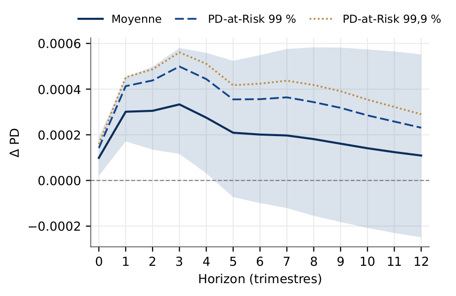
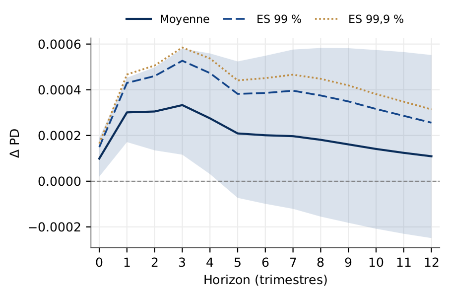

::: {.note-pdf}

[Télécharger la note (PDF)](../../assets/notes/STORM-note-stress-tests-credit.pdf){download="STORM-note-stress-tests-credit.pdf"}

:::

::: {.standfirst}

[En bref]{.lede}
Les stress tests de crédit disposent déjà d’un pont entre scénario macro-financier et probabilités de défaut (PD) : les modèles satellites. Mais ce pont ne transmet, le plus souvent, qu’une trajectoire moyenne. Lorsque la PD est une fonction non linéaire d’un facteur de crédit incertain, cette transmission partielle écarte l’incertitude prédictive du facteur de crédit : elle sous-estime alors les niveaux projetés de PD, jusqu’à $8\%$ dans notre application, et ne dit rien de la queue de distribution, là où se décident provisions et capital. Cette note présente un cadre qui complète les satellites existants, sans les remplacer. Il corrige d’abord la PD moyenne en intégrant la distribution complète du facteur de crédit, puis livre au même coût de calcul deux mesures de queue supplémentaires : PD-at-Risk et expected shortfall. Un stress test géopolitique sur le crédit américain sert de preuve de concept ; la même mécanique s’applique aux scénarios climatiques, monétaires ou sectoriels.

:::

::: {.message}

[Message central]{.label}

Il ne s’agit pas de remplacer les satellites existants, mais de leur faire produire davantage. En propageant la **distribution complète** du facteur de crédit, et non sa seule trajectoire moyenne, le même dispositif corrige la **PD moyenne** pour tenir compte de l’incertitude prédictive, puis délivre en forme close, sans simulation lourde et sans re-développement, deux mesures de queue complémentaires : le **PD-at-Risk** et l’**expected shortfall**, la mesure vers laquelle les régulateurs ont déjà fait basculer le risque de marché. Une correction de niveau et trois lectures du risque au prix d’une.

:::

## 1. Ce que la trajectoire moyenne ne transmet pas

Le stress testing est au cœur du pilotage des risques (IFRS 9, ICAAP, exercices prudentiels) et son périmètre s’élargit chaque année. L’architecture est bien rodée : un modèle macro-financier propage le scénario, un satellite de crédit le traduit en risque de portefeuille, dans la tradition des modèles satellites utilisés en interne comme dans les exercices prudentiels (Wilson, 1997 ; Henry et Kok, 2013).

La marge de progrès est dans la façon dont le scénario traverse cette chaîne : en pratique, il est propagé comme une trajectoire *moyenne*, ou comme un chemin supposé connu, puis la cartographie de crédit est évaluée le long de ce chemin. Utile, cette approche devient incomplète dès que la PD est **non linéaire** dans les conditions de crédit : la cartographie appliquée à la moyenne ne donne ni la moyenne de la PD, ni sa queue. En écartant l’**incertitude prédictive**, l’approximation joue, par convexité, toujours dans le même sens : elle **sous-estime** le niveau des PD.

::: {.why}

[Pourquoi c’est important]{.label}

- **Des niveaux de PD sous-estimés.** Le *plug-in* (PD évaluée sur la trajectoire moyenne) et la *perfect foresight* (chemin supposé connu) écartent tout ou partie de l’incertitude prédictive : dans notre application, les PD à trois ans sont sous-estimées de $7$ à $8\%$, un biais direct sur provisions et capital.
- **Pas de mesure de queue.** Ni quantile de PD, ni expected shortfall : seule sort une trajectoire centrale, alors que le risque se matérialise dans la queue, plus réactive.
- **Une hypothèse peu documentée.** La dispersion du facteur de crédit est écartée sans justification explicite, un point d’attention croissant pour la validation interne comme pour le superviseur.

:::

## 2. Corriger le niveau, révéler la queue : l’architecture

Le cadre se lit comme une chaîne de transmission (figure 1) : un choc macro-financier entre à gauche ; à droite sortent une PD moyenne corrigée de l’incertitude prédictive et deux mesures de queue. Entre les deux, deux blocs seulement, estimés séparément, et c’est là le point décisif en pratique : chaque bloc est **remplaçable par le modèle interne déjà validé** de l’établissement. Un bloc macro-financier dynamique (VAR bayésien) propage le choc ; le satellite de crédit reconstruit un facteur systémique $Z_t$, cartographié en PD via le modèle de Merton–Vasicek.

::: {#schema}

:::

**Une seule équation, déjà familière aux équipes de crédit.** Le cœur du satellite est le modèle de Merton–Vasicek (Merton, 1974 ; Vasicek, 2002 ; Gordy, 2003), le socle du cadre IRB de Bâle, qui relie le facteur systémique $Z_t$ à la PD conditionnelle du portefeuille :

$$\pi(Z_t) = \Phi\!\left( \frac{\Phi^{-1}(p)-\sqrt{\rho}\,Z_t}{\sqrt{1-\rho}} \right),$$

où $\Phi$ est la loi normale centrée réduite, $p$ la PD moyenne de long terme et $\rho$ la corrélation d’actifs. L’apport méthodologique tient en un geste : au lieu d’évaluer cette fonction sur une trajectoire moyenne, on y injecte la *distribution conditionnelle* complète de $Z_t$. Le résultat tombe en forme fermée, sans simulation : la réponse de la PD moyenne, désormais corrigée de l’incertitude prédictive, celle de ses quantiles (le **PD-at-Risk**, transposition du Growth-at-Risk (Adrian et al., 2019)) et celle de l’**expected shortfall**, la mesure cohérente vers laquelle le risque de marché a déjà basculé.

::: {.why}

[Ce que le cadre apporte]{.label}

- **Aucun re-développement** : le satellite interne, déjà documenté et validé, reste en place ; on lui « branche » un bloc macro-financier dynamique en amont.
- **Les historiques tels qu’ils sont** : le VAR exploite l’historique macro-financier long, le satellite s’estime sur la fenêtre plus courte des défauts, sans troncature ni raccord artificiel.
- **Une correction de niveau et deux mesures de queue, en forme fermée** : PD moyenne corrigée, PD-at-Risk *et* expected shortfall, au même coût de calcul, sans simulation d’événements de défaut. Industrialisable sur tout un catalogue de scénarios.
- **Gouvernance et traçabilité** : sortie analytique et reproductible, où chaque canal de transmission du scénario est explicite. Un atout en validation comme face au superviseur.

:::

::: {.storm-anim data-anim="credit"}

:::

## 3. Démonstration : un stress test géopolitique sur le crédit américain

Nous appliquons le cadre à un stress test géopolitique. Le choc est mesuré par le *Geopolitical Risk Index* de Caldara et Iacoviello (2022) ; le bloc macro-financier est estimé sur données trimestrielles américaines de 1986 à 2024 ; le satellite s’appuie sur le taux de défaut agrégé des banques commerciales américaines, avec une PD de long terme calibrée à $\hat p = 3{,}20\%$ et une corrélation d’actifs $\hat\rho = 0{,}051$. Un choc d’un écart-type sur l’indice est propagé jusqu’aux trois réponses de PD (figure 2).

::: {.note-figure}

::: {.note-figs}

:::

::: {.note-cap}
Figure 2. Réponses de queue de la PD à un choc géopolitique d’un écart-type : réponse moyenne (médiane a posteriori, bande à $68\%$) contre mesures de queue à $99\%$ et $99{,}9\%$.
:::

:::

::: {.keyfigs}

::: {.kf}
[+0,033 pp]{.v}
Pic de la PD moyenne, au 3e trimestre
:::

::: {.kf}
[+0,059 pp]{.v}
Pic de l’expected shortfall à $99{,}9\%$
:::

::: {.kf}
[× 4,6]{.v}
Écart de réponse selon l’état du cycle de crédit
:::

:::

Pris isolément, l’effet moyen corrigé reste modeste : $+0{,}033$ point de pourcentage au pic. Une lecture en trajectoire moyenne s’arrêterait là, sur un choc absorbable. Les deux résultats suivants montrent ce que cette lecture laisse de côté.

**La queue réagit une fois et demie à deux fois plus que le centre.** La courbure de la cartographie amplifie la réponse vers les quantiles extrêmes, ceux-là mêmes qui pilotent le capital et les provisions : le PD-at-Risk culmine à $+0{,}050$ point à $99\%$ et $+0{,}056$ à $99{,}9\%$, contre $+0{,}033$ pour la moyenne. L’expected shortfall va plus loin, à $+0{,}053$ et $+0{,}059$ point : il capture non seulement le seuil de queue, mais la sévérité moyenne au-delà. Aucun de ces chiffres n’est accessible en trajectoire moyenne.

**Le même choc peut peser jusqu’à $4{,}6$ fois plus selon le moment.** À choc identique, la réponse au pic varie d’un facteur $4{,}6$ selon l’état initial du crédit observé dans l’historique. L’illustration la plus parlante est une inversion (tableau 1) : la guerre du Golfe, choc plus petit mais survenu sur un crédit déjà dégradé, produit une réponse de PD supérieure à celle du 11 septembre, pourtant un choc plus violent. Un scénario calibré sans conditionnement à l’état courant du crédit peut donc sous-évaluer sensiblement l’impact.

| Épisode | PD à la date (pp) | Choc (é.-t.) | Pic $\Delta$PD choc réel (pp) | Pic $\Delta$PD choc 1 é.-t. (pp) | Ratio |
|:--|:-:|:-:|:-:|:-:|:-:|
| Guerre du Golfe (1990 T3) | 4,59 | 3,14 | 0,278 | 0,087 | 2,59 |
| 11 septembre (2001 T3) | 1,97 | 4,45 | 0,219 | 0,047 | 1,41 |
| Invasion de l’Ukraine (2022 T1) | 1,36 | 3,54 | 0,106 | 0,029 | 0,87 |
| Fin d’échantillon (2025 T1) | 1,45 | n.a. | n.a. | 0,033 | 1,00 |

: Tableau 1. Épisodes géopolitiques évalués dans leurs conditions initiales : le « choc réel » rejoue l’innovation historique ; le choc commun d’un écart-type isole la dépendance à l’état du crédit.

::: {.retenir}

[Lecture pour les équipes risques]{.label}

L’enseignement n’est pas « le risque géopolitique fait grimper les défauts ». C’est que la **queue de distribution** et l’**état du cycle de crédit** commandent la réponse bien plus que la taille nominale du choc, deux dimensions inaccessibles en trajectoire moyenne. Le géopolitique n’est qu’un banc d’essai : la même architecture sert tout autre scénario.

:::

## 4. Mise en œuvre

Le déploiement suit trois étapes, sans rupture avec l’existant :

1. **Conserver le satellite de crédit interne.** Le cadre se branche sur le modèle déjà validé et documenté ; seul le facteur systémique $Z_t$ qu’il produit est requis.
1. **Brancher un bloc macro-financier dynamique en amont.** Un VAR estimé sur l’historique macro-financier long, intégrant la variable de scénario retenue (géopolitique, climat, taux, incertitude, secteur).
1. **Produire les trois sorties pour chaque scénario du catalogue.** PD moyenne, PD-at-Risk et expected shortfall sortent en forme close, prêtes à alimenter le dossier IFRS 9 / ICAAP.

::: {.retenir}

[À retenir pour chaque équipe]{.label}

- **Stress testing / ICAAP** : un pont unique, réutilisable pour tous les scénarios du catalogue, au lieu d’un modèle *ad hoc* par exercice.
- **IFRS 9** : corriger un biais de sous-estimation des PD de l’ordre de $7$ à $8\%$ à trois ans, le plus marqué dans les états dégradés qui pèsent sur les provisions.
- **Capital et provisions** : disposer de l’expected shortfall en complément du quantile de queue, au même coût, comme déjà opéré en risque de marché.
- **Validation / risque de modèle** : une chaîne analytique, séparable et traçable, plus simple à challenger qu’une simulation jointe opaque.
- **CRO** : lire le risque dans la queue autant que dans la moyenne, et documenter la diffusion du choc jusqu’au portefeuille.

:::

Ce cadre ne remplace pas les exercices existants : mêmes satellites, même coût de calcul, mais des niveaux de PD corrigés, deux mesures de queue en plus et une transmission auditable. Le groupe Square Management est à la disposition des équipes intéressées pour échanger sur son application.

## Article de recherche associé

Flament, G., Hurlin, C., Lajaunie, Q. & Pull, Y. (2026). *Generalized Impulse Responses of Portfolio Default Probabilities: A Modular Framework with an Application to Geopolitical Risk.*
[arXiv:2608.04469](https://arxiv.org/abs/2608.04469) · [SSRN](https://papers.ssrn.com/sol3/papers.cfm?abstract_id=7106918)



## Références

::: {.refs}

Adrian, T., Boyarchenko, N. & Giannone, D. (2019). Vulnerable growth. *American Economic Review*, 109(4), 1263–1289.

Caldara, D. & Iacoviello, M. (2022). Measuring Geopolitical Risk. *American Economic Review*, 112(4), 1194–1225.

Flament, G., Hurlin, C., Lajaunie, Q. & Pull, Y. (2026). *Generalized Impulse Responses of Portfolio Default Probabilities: A Modular Framework with an Application to Geopolitical Risk*.

Gordy, M. B. (2003). A risk-factor model foundation for ratings-based bank capital rules. *Journal of Financial Intermediation*, 12(3), 199–232.

Henry, J. & Kok, C. (2013). A Macro Stress Testing Framework for Assessing Systemic Risks in the Banking Sector. In *Handbook of Systemic Risk*, 619–640.

Merton, R. C. (1974). On the pricing of corporate debt: The risk structure of interest rates. *The Journal of Finance*, 29(2), 449–470.

Vasicek, O. (2002). The distribution of loan portfolio value. *Risk*, 15(12), 160–162.

Wilson, T. C. (1997). Portfolio credit risk. *RISK*, 10(10), 56–61.

:::
